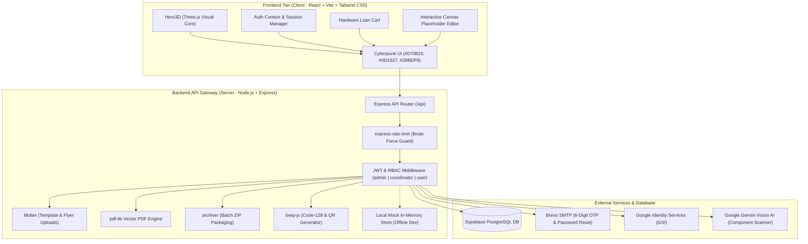
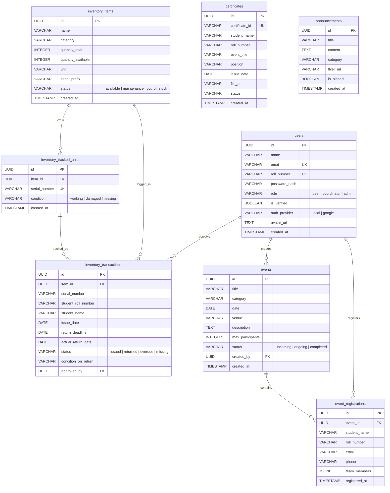
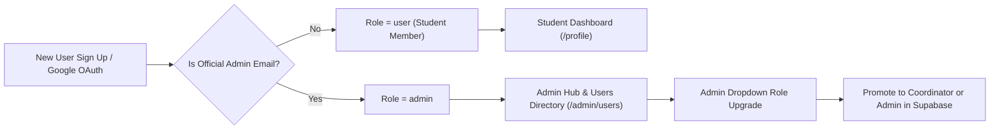
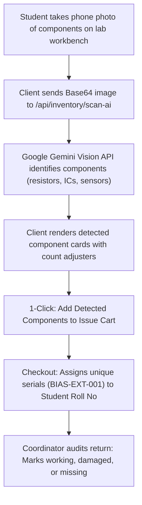
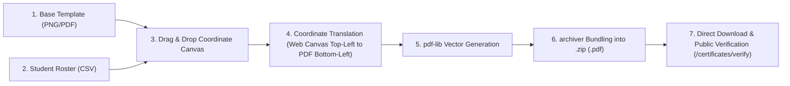
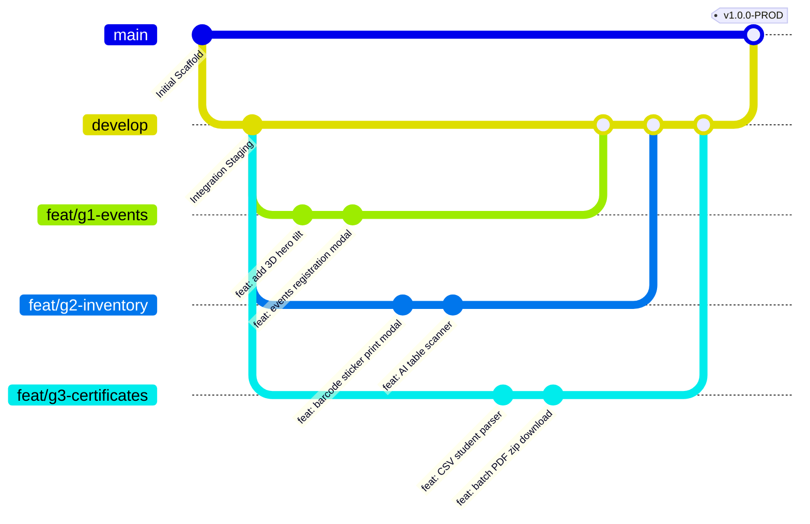

# 🏗️ Technoforum BIAS: Industry Architecture & Mind Map
### System Design, Data Models, Workflows & Engineering Protocols

This document serves as the **Master Engineering Architecture Blueprint** for the Technoforum Centralized Platform. All 6 interns and group leads should study these diagrams to understand how their assigned micro-modules interconnect.

---

## 1. High-Level System Architecture

---

## 2. Database Entity-Relationship Diagram (ERD)

The relational schema created by `database/supabase_schema.sql`:

---

## 3. Modular Engineering Mind Maps

### Module A: Authentication, RBAC & Role Management

### Module B: Smart Hardware & AI Vision Scanner

### Module C: E-Certificate Studio Engine

---

## 4. Git Collaboration Protocol (Git Flow)

To ensure 6 interns working concurrently do not step on each other's code or create catastrophic merge conflicts, follow this strict Git Flow:

### Branching Rules
1. **`main`**: Protected production branch. **Direct pushes are forbidden**.
2. **`develop`**: Central integration branch. All feature branches branch off `develop`.
3. **Feature Branches**:
   - Group 1: `feat/g1-landing-3d`, `feat/g1-events`
   - Group 2: `feat/g2-inventory`, `feat/g2-ai-scanner`
   - Group 3: `feat/g3-certificate-studio`, `feat/g3-verification`

### Conventional Commit Standards
All commits must follow standard prefixes:
* `feat:` A new user-facing feature (e.g., `feat(inventory): add barcode print modal`)
* `fix:` A bug fix (e.g., `fix(auth): handle expired token redirect`)
* `docs:` Documentation changes (e.g., `docs(readme): add setup guide`)
* `style:` Formatting, indentation, missing semi-colons (no code logic change)
* `refactor:` Code restructuring without changing behavior

---

## 5. Definition of Done (DoD) for Pull Requests

Before an intern submits a Pull Request to `develop`, they must verify:
- [ ] Code builds without errors (`npm run build:client` and `node --check server/src/index.js`).
- [ ] No hardcoded passwords, tokens, or personal API keys in the code.
- [ ] All API responses adhere to the standard JSON envelope: `{ success: boolean, message: string, data?: any }`.
- [ ] Responsive design verified on both Desktop (1920x1080) and Mobile (375x667).
- [ ] Dark blue cyber aesthetic maintained (`#070B19`, `#0D1527`, `#38BDF8`).
- [ ] Clear PR description referencing the Group Task ID from `docs/INTERN_TASKS.md`.
